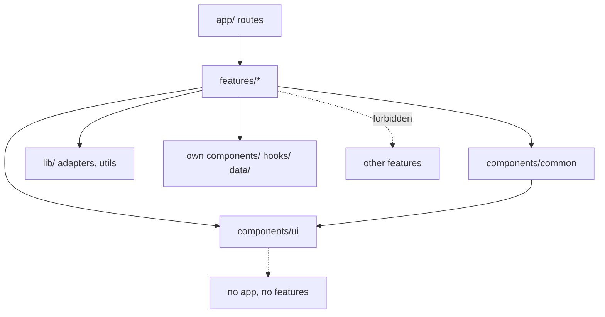

# Frontend Architecture

**Scope:** the `frontend/` app only. Backend, canister, hardware, and deployment architecture live in the root `docs/`.
**Read first:** [`rules.md`](./rules.md).
**Last updated:** 2026-10-28

---

## 1. Stack (actual, not aspirational)

| Layer | Choice | Version | Notes |
| --- | --- | --- | --- |
| Framework | Next.js App Router | 16.4.3 | Not the Next.js from older training data — read `node_modules/next/dist/docs/` before using unfamiliar APIs |
| UI runtime | React | 19.3.0 | React Compiler enabled |
| Language | TypeScript | 5.x, `strict: true` | No `any`, no `@ts-ignore` |
| Styling | Tailwind CSS | 4.x | CSS-first config via `@theme inline`; loaded through `@tailwindcss/turbopack` |
| Lint | ESLint | 9, flat config | `eslint-config-next` core-web-vitals + TypeScript |
| Alias | `@/*` | — | Resolves to `frontend/` (e.g. `@/features/dashboard/dashboard`) |
| Bundler | Turbopack | — | Configured in `next.config.ts` |
| Cache model | `cacheComponents: true`, `partialPrefetching: true` | — | Dynamic by default; `use cache` is opt-in |
| Testing | Not set up yet | — | Verification is lint + typecheck + build for now |

Approved additions: **mapcn** (vendored in `components/ui/map.tsx`) with its dependencies `maplibre-gl`, `lucide-react`, and `@types/geojson`. There is still **no UI kit, state library, data-fetching library, or chart library**. Adding one requires approval per `rules.md` §3.

---

## 2. Directory layout

```
frontend/
├── app/                        # Routing only. Thin files.
│   ├── layout.tsx              # Root shell, fonts, metadata
│   ├── globals.css             # Tailwind import + design tokens
│   ├── page.tsx                # "/" → dashboard
│   └── <route>/page.tsx        # Each route renders one feature
├── components/
│   ├── ui/                     # Global primitives (Button, Card, Modal, ...)
│   └── common/                 # App chrome (Header, BottomNav, Footer, ...)
├── docs/                       # This documentation set
│   ├── README.md               # Index and read order
│   ├── rules.md
│   ├── architecture.md
│   ├── skills.md
│   ├── glossary.md
│   ├── design.md
│   └── roadmap.md
├── features/                   # Product code only
│   ├── dashboard/
│   │   ├── dashboard.tsx       # Feature root (composition + data wiring)
│   │   ├── components/         # Components used only by this feature
│   │   ├── data/               # mock.ts, adapters/ (later)
│   │   ├── hooks/              # Optional, feature-local
│   │   ├── types.ts            # Domain types for this feature
│   │   └── README.md           # Optional: feature-specific notes
│   └── battery-leasing/
│       └── ...same shape
└── public/                     # Static assets
```

The `app/` directory deliberately contains almost nothing. If a route file grows past composing a feature and setting metadata, the logic belongs in `features/`.

---

## 3. Dependency rules



Hard rules:

1. **A feature may not import another feature.** Need it twice? Promote the shared part to `components/ui` or `lib/`.
2. **`components/ui` imports nothing from `features/`, `app/`, or `components/common`.** Primitives are leaves.
3. **`components/common` may use `components/ui`, never `features/`.**
4. **`app/` imports a feature root only** (`@/features/dashboard/dashboard`), not its internal files.
5. **No barrel files** (`index.ts`) inside features. Explicit imports keep the graph visible.
6. **No deep relative imports across folders.** Use `@/`.
7. **Types flow one way:** a feature may define and export its own domain types; shared types go to `lib/types/` when they truly serve multiple features.

If a rule feels wrong, update this file with approval — don't route around it.

---

## 4. Anatomy of a feature

`features/dashboard/` is the template:

```
dashboard/
├── dashboard.tsx              # Root: <section> layout + composition, default export
├── components/
│   ├── battery-status-card.tsx
│   ├── active-leases-list.tsx
│   ├── trading-summary.tsx
│   ├── quick-actions.tsx
│   └── notification-center.tsx
├── data/
│   └── mock.ts                # mockBatteries, mockLeases, mockNotifications
├── hooks/
│   └── use-battery-status.ts  # Simulated live status (client)
└── types.ts                   # Battery, Lease, Notification, ...
```

Conventions:

- The root file is named after the folder: `dashboard/dashboard.tsx`, `battery-leasing/battery-leasing.tsx`.
- Root component name is PascalCase and matches: `export default function Dashboard()`.
- The root does composition and data selection. It should stay readable in one screen.
- Local components take plain props; they do not import mocks directly unless they are explicitly demo-only.
- A feature may export additional named components if a route needs them. Keep the default export as the main entry.

Illustrative composition:

```tsx
// features/dashboard/dashboard.tsx
import { BatteryStatusCard } from "./components/battery-status-card";
import { ActiveLeasesList } from "./components/active-leases-list";
import { QuickActions } from "./components/quick-actions";

export default function Dashboard() {
  return (
    <div className="flex flex-col gap-4 p-4">
      <BatteryStatusCard />
      <ActiveLeasesList />
      <QuickActions />
    </div>
  );
}
```

```tsx
// app/page.tsx
import Dashboard from "@/features/dashboard/dashboard";

export default function HomePage() {
  return <Dashboard />;
}
```

---

## 5. Server vs client components

Default: **server**. Add `"use client"` only where it is needed.

| Needs | Where the directive goes |
| --- | --- |
| `useState`, `useEffect`, event handlers, `usePathname`, browser APIs | The smallest component that needs it |
| Static layout and markup | No directive |
| A whole screen that is a live dashboard | A client "island" inside a server feature root |

Rules:

- Never mark `app/**/page.tsx` as `"use client"`. Pages stay server components.
- Prefer passing data down into a small client island rather than making the parent client.
- Client components receive serializable props only.
- Interactive state lives close to the interaction. Do not lift state "just in case".
- With React Compiler on, do not add `useMemo` / `useCallback` / `React.memo` speculatively.

Pattern for the dashboard's simulated live data:

```tsx
// features/dashboard/components/battery-status-card.tsx
"use client";

import { useEffect, useState } from "react";
import type { BatteryStatus } from "../types";

export function BatteryStatusCard({ initial }: { initial: BatteryStatus }) {
  const [status, setStatus] = useState(initial);

  useEffect(() => {
    const id = setInterval(() => setStatus(simulateTick), 5_000);
    return () => clearInterval(id);
  }, []);

  // ...
}
```

The timer exists only because the backend is mocked. When real telemetry lands, replace the hook internals — not the components that consume it.

---

## 6. Routing

Routes are thin. Proposed map (update when a route is actually created):

| Route | Feature | Purpose |
| --- | --- | --- |
| `/` | `features/dashboard` | Main dashboard (built, inside the `(app)` shell) |
| `/login` | `features/auth` | Mock email/password login with visible demo credentials |
| `/signup` | `features/auth` | Mock sign-up; accounts live in memory until reload |
| `/batteries` | `features/battery-leasing` | List + mapcn map. `?view=map`, `&map=dark\|satellite` picks the basemap (Color is the default), `?battery=<id>` selects, `&sheet=details` opens the details sheet (deep link) |
| `/batteries/lease` | `features/battery-leasing` | Lease wizard **and** the simulated payment phase (`?battery=<id>`). One route keeps the single wizard state object |
| `/leases` | `features/battery-leasing` | Lease management. `?tab=past` shows returned leases (default is current), `?lease=<id>` opens the detail view |
| `/trading` | `features/trading` | Battery tracking + energy trading. `?tab=market\|tracking\|portfolio`, `?offer=<id>` opens the buy sheet, `&sheet=new-offer` opens the offer sheet |

Not created (superseded): `/batteries/[batteryId]` → `?battery=&sheet=details`; `/batteries/lease/payment` → payment phase inside `/batteries/lease`; `/notifications` → notification sheet opened from the dashboard bell.

Routes inside `app/(app)/` share `components/common/app-shell.tsx` (centered column + bottom nav). `/login` and `/signup` sit outside it.

Every data surface honors `?demo=loading|empty|error` (see `lib/mock/use-simulated-load.ts`) so all four UI states are reachable in the demo; with `error`, the first load fails and "Try again" succeeds.

Conventions:

- Use a route group `(app)/` if/when a shared authenticated shell is introduced. Route groups do not affect the URL.
- Use typed helpers instead of hand-written prop types: `PageProps<"/batteries/[batteryId]">`, `LayoutProps<"/">` — generated by Next, no import needed.
- `params` and `searchParams` are async in this version. Await them.
- Modals that users may deep-link or refresh into get a real URL (`?battery=` or a segment). Pure confirmations stay local state.
- Navigation uses `next/link`; programmatic navigation uses `useRouter` inside a client component.
- No `router.refresh()` as a substitute for state management.
- Metadata is set per route via `export const metadata` / `generateMetadata` in server files.

---

## 7. Data layer (mock now, adapters later)

Today every feature reads from `data/mock.ts`. Components never call an API directly.

```
data/
├── mock.ts                 # static fixtures + small in-memory mutations
└── adapters/               # later: canister/API adapters with the same shapes
```

Guidelines:

- `types.ts` holds the domain model. Both mock and future adapters implement it.
- Mock data is typed, not `as const` blobs of untyped objects.
- Provide variety: healthy battery, low battery, charging, unavailable, expired lease, active lease, empty list.
- Simulated latency is introduced inside a hook or adapter (e.g. `await delay(400)`), never scattered through components.
- Writes are in-memory only. Reloading resets them. UI copy must not promise persistence.
- When real data arrives, only the adapter changes. Component props keep their shape.

Illustrative types:

```ts
// features/dashboard/types.ts
export type BatteryStatus = "charging" | "in-use" | "idle" | "fault";

export type Battery = {
  id: string;
  label: string;
  status: BatteryStatus;
  chargePercent: number;
  healthPercent: number;
  location: { lat: number; lng: number; label: string };
};

export type Lease = {
  id: string;
  batteryId: string;
  startedAt: string;   // ISO string, format at render
  endsAt: string;
  status: "active" | "ending-soon" | "overdue" | "completed";
  costMinorUnits: number;
  currency: "PHP";
};
```

---

## 8. State and forms

- Local UI state: `useState` / `useReducer` in the component that owns it.
- Shared within one feature: React Context created in that feature (`features/<feature>/context/`), not a global store.
- Across features: there is no global store. If one becomes necessary, it needs an approved decision entry below.
- URL is state for anything shareable: filters, selected tab, wizard step, selected battery.
- No state library until a real need is measured and approved.
- Forms: native controls, `label` + `htmlFor`, per-field error text tied via `aria-describedby`, validate on blur + submit.
- A multi-step wizard keeps a single state object and validates per step. Do not navigate between steps with separate forms that re-mount.

---

## 9. Styling and tokens

- Tailwind v4 utilities in JSX; global CSS is for tokens and base resets only.
- Tokens are CSS variables declared in `app/globals.css` and exposed to Tailwind with `@theme inline`.
- Components use semantic classes (`bg-canvas`, `bg-surface`, `text-ink`, `text-ink-muted`, `border-line`, `bg-primary`), never raw palette values.
- No hex codes in `.tsx`. No arbitrary values like `bg-[#123456]`.
- `globals.css` holds the approved brand palette (`design.md` §4.3). Brand accents `brand-green` and `brand-blue` are for fills, gradients, and the logo only.
- Class ordering: layout → spacing → typography → color → state. Keep it consistent; no formatter enforces it yet.
- No `cn()` helper exists yet. Add it (with approval) when the second primitive needs conditional classes.

---

## 10. Loading, errors, and edge cases

- With `cacheComponents` on, prerendering works differently than older App Router guides. Do not add `fetch` cache options by habit, and do not assume a page is static.
- Use `Suspense` boundaries around anything async so the shell can stream. Skeletons live beside the component they replace.
- With mock data, loading is simulated in the hook; the skeleton component is still real and reused later.
- Error boundaries: a route-level `error.tsx` is added when a route exists. Do not swallow errors in `catch` blocks.
- Empty states are designed, not accidental: short title, one sentence, one action.
- Guard every optional field in mock data at render time; no `!` assertions.

---

## 11. Verification

Run from `frontend/`:

```bash
npm run lint
npx tsc --noEmit
npm run build
```

Manual checks for UI work:

- 360px, 768px, and desktop widths.
- Keyboard only: tab order, focus visible, modal trap, `Escape`.
- All four states per data surface.
- Reduced motion enabled.
- Long content and missing optional values do not break layout.

No test runner is configured yet. When one is approved, colocate tests as `<component>.test.tsx` next to the component and keep the same folder structure.

---

## 12. Adding a feature

1. Read `rules.md`, this file, and the roadmap item.
2. Check the item does not belong to an existing feature. If it does, extend that feature.
3. Create `features/<feature>/` with `<feature>.tsx`, `types.ts`, `data/mock.ts`, `components/`.
4. Build primitive-first: if a control will be reused, add it to `components/ui/` (ask first if it changes tokens).
5. Wire a thin route in `app/`.
6. Cover loading, empty, error, ready.
7. Run the three checks, update the roadmap checkbox, write the report.

---

## 13. Decision log

Small, append-only. New decisions need the human's approval.

| Date | Decision | Reason |
| --- | --- | --- |
| 2026-10-28 | Next.js App Router over Vite SPA | Already scaffolded; server components and routing built in |
| 2026-10-28 | Feature-based folders over type-based (`components/`, `hooks/` at root) | Keeps one capability in one place; matches how the roadmap is split |
| 2026-10-28 | Feature roots in PascalCase files matching folder name | Predictable entry point per feature |
| 2026-10-28 | No UI/state/map/chart libraries yet | Keep bundle small; decide per feature when a real need appears |
| 2026-10-28 | Tailwind v4 tokens, no CSS modules | One styling system, themable later |
| 2026-10-28 | Mock data first, adapters later | Backend is not ready; UI must not block on it |
| 2026-10-28 | Palette deferred | Design direction approved, values not chosen |
| 2026-10-28 | Mock email/password login at `/login` + `/signup`, hardcoded demo credentials shown on screen | Human-approved base screen; real login will be Internet Identity behind an adapter. No session is created |
| 2026-10-28 | Neutral placeholder token values in `globals.css` | Human-approved so components can use token names before the palette is chosen |
| 2026-10-28 | Energy trading + battery tracking on `/trading`, with a fourth bottom-nav item | Human-approved scope change; the roadmap previously excluded trading screens. Still mock-only, with URL-held view state |
| 2026-10-29 | Simplify every screen for older riders and tricycle drivers | Human request. Bigger text and buttons (primitives), plain words, two lease tabs, no trading sort, no start-time step, no GPS preview or usage chart, battery list shows only leasable batteries. Clutter labels like "Demo data" removed; the "no money will be taken" note stays on every money action (`rules.md` §4) and on issue reports. `tracking-map.tsx` and `usage-chart.tsx` are now unused, kept until deletion is approved |
| 2026-10-29 | No on-screen demo or simulation labels on the dashboard (`/`) | Human request. Data is still mock and labelled in code comments (allowed by `rules.md` §4). The dashboard must not show a payment as completed, so the "Payment received" notification was replaced. Other screens (payment, leases, trading, batteries, auth) keep their labels |
| 2026-10-29 | mapcn (MapLibre GL) for the battery map, with Color (CARTO Voyager), Dark (CARTO Dark Matter), and Satellite (Esri World Imagery) basemaps | Human-approved. No API keys. External requests: CARTO and Esri tiles, and MapLibre's worker script from unpkg (mapcn default). `components/ui/map.tsx` is vendored: opted out of React Compiler with `"use no memo"`; shadcn token names are aliased in `globals.css`; `lib/utils.ts` provides its `cn` |
| 2026-10-29 | Brand palette and logo from the Figma file "chargex" replace the placeholder tokens | Human-approved. Deep teal primary, green and blue teal accents, mint, charcoal, off-white; logo exported to `public/brand/` and served through `components/common/logo.tsx` |
